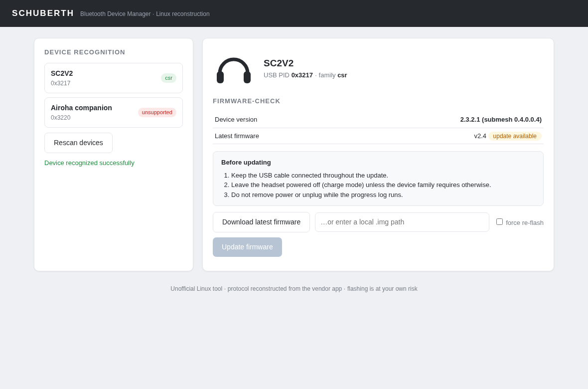

# schuberth-dfu

Linux firmware updater for SCHUBERTH (and SENA) motorcycle headsets, built
from reverse-engineering the vendor's Windows/macOS "Bluetooth Device
Manager" apps. Protocol evidence and analysis: `docs/analysis/findings.md`.

**Unofficial project.** Not affiliated with, endorsed by, or sponsored by
SCHUBERTH/HJC or SENA Technologies. All trademarks belong to their owners;
vendor firmware is not distributed here (installers are gitignored, with
their SHA-256s recorded in findings.md).

**Status: partially hardware-validated.** Detection, manifest lookup,
firmware download + container verification, and the update flows are
implemented and unit-tested against simulated devices. The SC2V2
(092b:3217 + 092b:3220) transport and command framing are confirmed on
live hardware (2026-10-18, see findings.md "Live SC2V2 USB topology");
the SC2V2 update runs over raw USB because the vendor's HID report
descriptors are malformed and the Linux kernel HID stack cannot drive
them. Other device families remain untested on hardware.

## Install (dev)

```
python3 -m venv .venv && . .venv/bin/activate
pip install -e .[dev]
```

For device access: `pip install hidapi pyusb`, plus the udev rule:

```
sudo cp udev/99-schuberth-dfu.rules /etc/udev/rules.d/
# make sure your user is in the plugdev group
```

The SC2V2/SC1 raw-USB path additionally needs permission on the USB
device nodes (it detaches `hid-generic`): install the udev rule below
(one-time, then no root is needed), or run `version`/`update` with
`sudo`/`pkexec`.

## Usage

```
schuberth-dfu detect                 # list connected supported headsets
schuberth-dfu check SC2              # latest firmware for product SC2
schuberth-dfu check SC2 --all-revisions
schuberth-dfu download SC2 -o sc2.img  # download + verify all MD5s
schuberth-dfu version                # live versions (SC2V2, read-only)
schuberth-dfu update --image sc2.img --yes   # flash connected device
schuberth-dfu ui                    # local web UI (device list + update)
schuberth-dfu selftest       # run both update flows against simulated devices
```

## Graphical interface

`schuberth-dfu ui` serves a local web app (default
`http://127.0.0.1:8737/`, opens your browser) mirroring the vendor app's
flow for consistency: **Device recognition** (live USB scan) →
**Firmware-Check** (server manifest vs device version) → **precaution
steps** → **update with live progress log**. The UI reuses the same
package flows and refuses concurrent flashes; the final confirm dialog
is the `--yes` equivalent. Its look is rebuilt with neutral inline
assets — the vendor's proprietary icons are deliberately not shipped.


*Demo state via `python3 tools/ui_demo.py` (simulated SC2V2 — no
hardware touched).*

Product names are the internal catalog keys (see
`docs/analysis/pid-catalog.csv`), e.g. `SC2`, `SC2V2`, `ST1`, `PRISM`.

## Supported devices (plan)

| Product | PID | Family | Status |
|---|---|---|---|
| SC2 | 0x3170 | CSR | flow implemented (experimental, untested on hw) |
| SC2V2 | 0x3217 | CSR | **updated a live device 2.3.2.1 → 2.4.0.0** (vendor-exact flow) |
| SC1A / SC10U / SC1S | 0x5622 / 0x5623 / 0x5624 | SC1 | static vendor model implemented + sim-tested; live hw test pending |
| SC1M | 0x6400 | SC1 | same generic flow (device_id from its v1.1 container); hw test pending |
| ST1/S1/M1 EVO/C30/… | various | Airoha | command+block loop implemented (untested on hw) |
| UCOM3/3HD/6R/7R | 0x3340/0x3341/0x3430/0x3420 | QCC | static vendor model + APPUHDR5 grammar; hw test pending |
| PRISM | 0x3020 | disk-copy | container decoded; update = drop-file copy to MSC volume — flow intentionally not wired yet (needs hw) |

## Tests

```
pytest
# against real firmware images you downloaded:
SCHUBERTH_TEST_IMGS=/path/st1.img:/path/sc2.img pytest
```

## Safety

Flashing firmware can brick a headset. This project is unofficial; only
proceed on your own risk. Never unplug power during an update.

## License

GPL-3.0-or-later. Deliberately copyleft: anyone (including the headset
vendors) may use and extend this work, but must keep distributed
derivatives open under the same license. Vendor firmware, installers and
their contents are not part of this work and not covered by this license.
